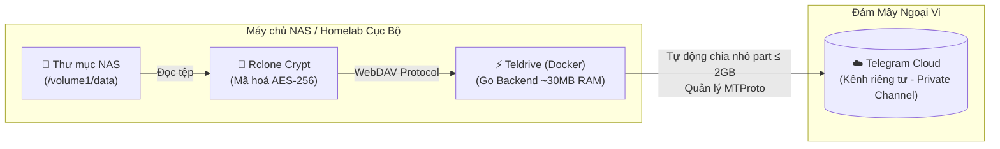

# Telegram NAS Backup 🚀
> **Giải pháp sao lưu dữ liệu NAS lên Telegram Cloud không giới hạn với Teldrive, Rclone Crypt & Docker.**

[](https://www.docker.com/)
[](https://github.com/tgdrive/teldrive)
[](https://rclone.org/)
[](LICENSE)

Dự án này cung cấp một bộ công cụ triển khai trọn gói (*turnkey solution*) giúp bạn biến Telegram thành một **kho lưu trữ sao lưu ngoại vi (Offsite Cold Storage / Disaster Recovery)** an toàn, tự động hóa và bảo mật tuyệt đối cho các hệ thống NAS (**Synology DSM, TrueNAS, Unraid, OpenMediaVault, Proxmox, Ubuntu/Debian Server**).

---

## 🏗 Kiến trúc hoạt động



### ✨ Ưu điểm vượt trội
1. **Dung lượng không giới hạn**: Lưu trữ miễn phí trên hạ tầng Telegram.
2. **Bảo mật tuyệt đối (Zero-Knowledge)**: Mọi tệp tin, tên tệp và cấu trúc thư mục đều được mã hoá bằng thuật toán **AES-256** qua `rclone crypt` trước khi rời khỏi NAS. Phía Telegram chỉ thấy các chuỗi nhị phân mã hoá vô nghĩa.
3. **Tự động chia nhỏ file lớn (> 2GB)**: Teldrive tự động cắt các tệp lớn thành các phần nhỏ $\le 2\text{GB}$ khi tải lên và tự động ghép nối lại khi tải xuống.
4. **Cực kỳ nhẹ**: Container Teldrive viết bằng Go chỉ tốn $\approx 30\text{MB}$ RAM, phù hợp với cả các mẫu NAS cấu hình thấp (ARM / 1GB RAM).
5. **Chống nghẽn mạng & Rate Limit**: Cấu hình giới hạn băng thông (`--bwlimit 15M`) và `--fast-list` giúp bảo vệ đường truyền gia đình và tránh bị Telegram khoá IP (`FLOOD_WAIT`).
6. **Thông báo qua Telegram Bot**: Nhận báo cáo tự động qua bot cá nhân sau mỗi lần backup thành công hoặc thất bại.

---

## 📂 Cấu trúc dự án

```text
.
├── docker-compose.yml           # Khai báo dịch vụ Postgres, Teldrive & Rclone Backup runner
├── .env.example                 # Mẫu biến môi trường (Database, đường dẫn NAS, Cronjob)
├── config.example.toml          # Mẫu cấu hình Teldrive v2 (API ID, API Hash, Allowed Users)
├── rclone/
│   └── rclone.example.conf      # Mẫu cấu hình Rclone WebDAV & Crypt remote
└── scripts/
    ├── setup.sh                 # Script tự động tạo thư mục và sinh khoá bảo mật ngẫu nhiên
    ├── backup.sh                # Script backup chạy trên máy chủ NAS (hỗ trợ lock & log)
    ├── restore.sh               # Script giải mã và khôi phục dữ liệu từ Telegram về NAS
    ├── container_backup.sh      # Script backup tự động chạy ngầm trong Docker
    └── install_cron.sh          # Hướng dẫn và cài đặt lịch chạy tự động (Cronjob)
```

---

## ⚡ Hướng dẫn cài đặt nhanh trong 15 phút

### Bước 1: Chuẩn bị thông tin Telegram
1. Đăng nhập vào [my.telegram.org](https://my.telegram.org), chọn **API development tools** để lấy `app-id` (số) và `app-hash` (chuỗi ký tự).
2. Mở ứng dụng Telegram trên điện thoại/máy tính, tạo một **Kênh riêng tư (Private Channel)** mới (ví dụ đặt tên là `NAS_Backup_Vault`).
3. *(Khuyên dùng)* Nên dùng một tài khoản phụ (Secondary/Burner Account) để chứa dữ liệu backup.

---

### Bước 2: Clone dự án và khởi tạo cấu hình
SSH vào NAS hoặc máy chủ Linux của bạn:

```bash
git clone https://github.com/thanhvo-agy/Telegram-Drive.git telegram-backup
cd telegram-backup

# Cấp quyền và chạy script khởi tạo tự động
chmod +x scripts/*.sh
./scripts/setup.sh
```

Script sẽ tự động:
- Tạo các thư mục lưu trữ `data/`, `logs/`, `rclone/`.
- Tạo `.env` và `config.toml` với mật khẩu PostgreSQL và khoá bí mật JWT ngẫu nhiên.

---

### Bước 3: Cập nhật thông tin cấu hình

1. **Cập nhật `config.toml`**:
   Mở file `config.toml` và điền:
   ```toml
   [jwt]
   allowed-users = ["username_telegram_cua_ban"] # Không có dấu @

   [tg]
   app-id = 12345678                            # Lấy từ my.telegram.org
   app-hash = "chuoi_app_hash_cua_ban"          # Lấy từ my.telegram.org
   ```

2. **Cập nhật `.env`**:
   Mở file `.env` và chỉnh sửa đường dẫn thư mục NAS bạn muốn sao lưu:
   ```env
   # Ví dụ với Synology DSM:
   NAS_SOURCE_PATH=/volume1/data
   ```

---

### Bước 4: Khởi động Teldrive qua Docker

```bash
docker compose up -d
```

Kiểm tra trạng thái container:
```bash
docker compose ps
```
Khi cả 2 container `teldrive_postgres` và `teldrive_server` ở trạng thái **healthy / running**, mở trình duyệt truy cập:
👉 `http://<IP_NAS_CỦA_BẠN>:8080`

- Đăng nhập bằng số điện thoại Telegram của bạn.
- Vào phần **Settings** $\rightarrow$ chọn kênh Telegram riêng tư đã tạo ở Bước 1 làm thư mục lưu trữ mặc định.

---

### Bước 5: Cấu hình Rclone (WebDAV & Mã hoá Crypt)

1. Sao chép file cấu hình mẫu sang cấu hình chính thức:
   ```bash
   cp rclone/rclone.example.conf rclone/rclone.conf
   ```

2. Mã hoá mật khẩu truy cập của bạn bằng lệnh Rclone:
   ```bash
   # Nếu bạn cài rclone trên máy chủ:
   rclone obscure "MatKhauChonDeMaHoa"
   
   # Hoặc chạy nhanh qua Docker:
   docker run --rm rclone/rclone obscure "MatKhauChonDeMaHoa"
   ```

3. Mở `rclone/rclone.conf` và dán mật khẩu đã mã hoá vào các trường `pass` và `password`.

---

### Bước 6: Kiểm tra sao lưu và phục hồi

Chạy thử một lần sao lưu thủ công:
```bash
./scripts/backup.sh
```
Kiểm tra file log vừa sinh ra trong thư mục `logs/`. Bạn sẽ thấy tiến trình đồng bộ từng tệp đã được mã hoá đẩy lên Telegram.

Khi cần khôi phục dữ liệu về NAS:
```bash
# Khôi phục toàn bộ kho lưu trữ về thư mục ./restore_output
./scripts/restore.sh

# Hoặc khôi phục một thư mục con cụ thể:
./scripts/restore.sh teldrive-crypt:nas-backup/Photos /volume1/restore_photos
```

---

### Bước 7: Cài đặt lịch sao lưu tự động (Cronjob)

Chạy script hỗ trợ cài đặt cron:
```bash
./scripts/install_cron.sh
```

- **Đối với Synology DSM**:
  1. Vào **Control Panel** $\rightarrow$ **Task Scheduler** $\rightarrow$ **Create** $\rightarrow$ **Scheduled Task** $\rightarrow$ **User-defined script**.
  2. Tab **General**: User chọn `root`.
  3. Tab **Schedule**: Chạy hàng ngày lúc `02:00 AM`.
  4. Tab **Task Settings**: Dán lệnh:
     ```bash
     /bin/bash /duong/dan/den/telegram-backup/scripts/backup.sh
     ```

- **Đối với Linux / TrueNAS Scale / Unraid**:
  Thêm dòng sau vào crontab (`crontab -e`):
  ```bash
  0 2 * * * /bin/bash /duong/dan/den/telegram-backup/scripts/backup.sh >/dev/null 2>&1
  ```

---

## 🛡️ Các lưu ý sống còn khi Backup lên Telegram

> [!IMPORTANT]
> **Quy tắc sao lưu 3-2-1:** Hãy coi Telegram là bản sao lưu ngoại vi thứ 3 (**Disaster Recovery / Cold Storage**). Không nên dùng Telegram làm bản lưu trữ duy nhất. Luôn giữ ít nhất 1 bản sao dữ liệu gốc trên ổ cứng NAS tại nhà.

> [!CAUTION]
> **Bật mã hoá đầu cuối (Rclone Crypt):** Tuyệt đối không đẩy tệp tin gốc chưa mã hoá lên Telegram để đảm bảo tính riêng tư tuyệt đối cho dữ liệu gia đình và công việc của bạn.

> [!TIP]
> **Giới hạn tốc độ tải lên:** Đặt `RCLONE_BWLIMIT=15M` trong `.env` nhằm tránh việc đẩy quá dồn dập khiến Telegram kích hoạt giới hạn tần suất (`FLOOD_WAIT`).

---

## 📜 Giấy phép
Mã nguồn mở theo giấy phép [MIT License](LICENSE).
Teldrive là dự án mã nguồn mở phát triển bởi nhóm [tgdrive](https://github.com/tgdrive).
Rclone là công cụ mã nguồn mở phát triển bởi [rclone](https://rclone.org).
